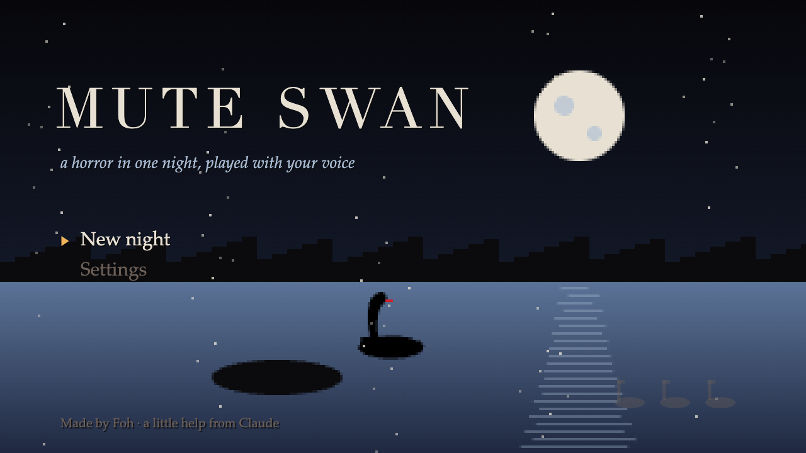
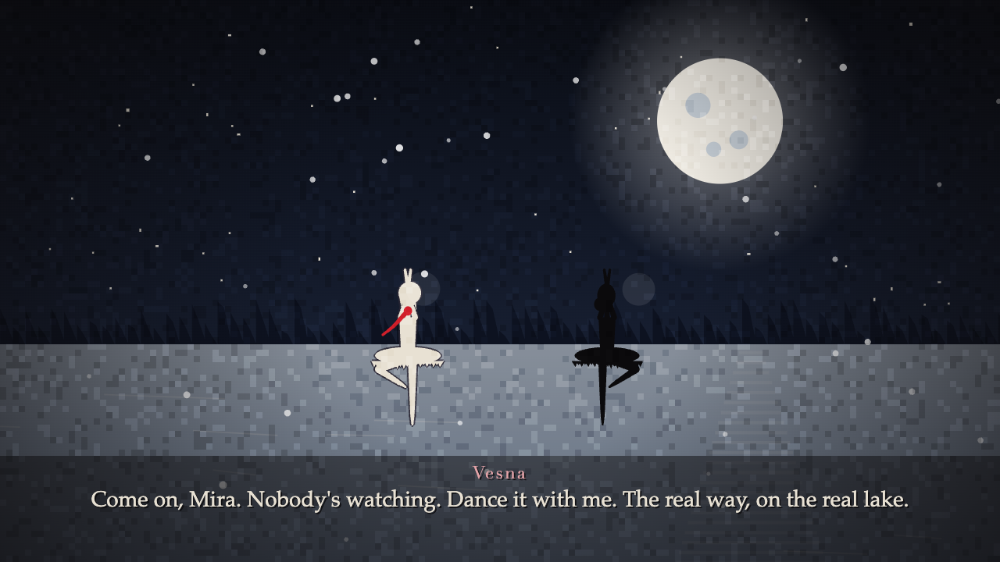
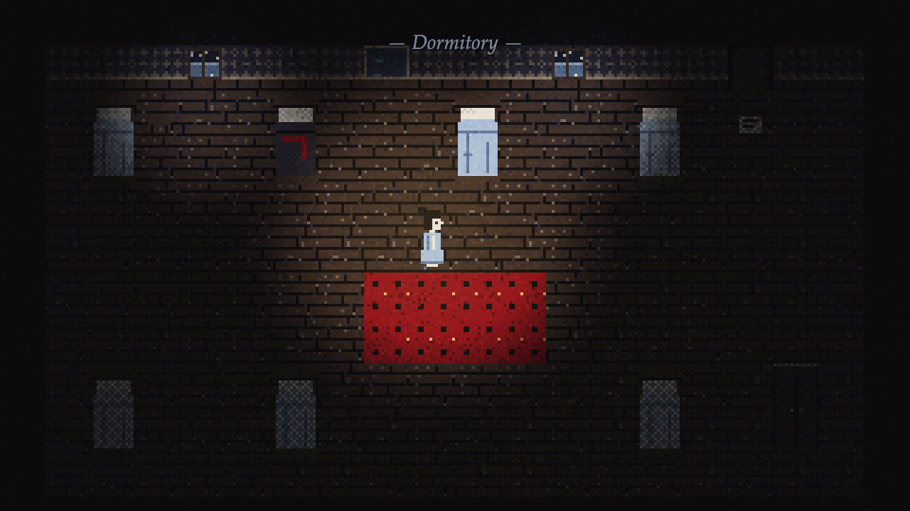

# MUTE SWAN

*A horror in one night, played with your voice.*

Mira has not spoken since the night the ice broke. Tonight, on the anniversary, the closed ballet
school is snowed in, the power is out, and someone is leaving her notes. You are her voice.

About 20–30 minutes.

**Content warning:** for adults. Death, gore, disturbing themes, swearing and smoking.

## Starting the game (Windows)

1. Unzip `MuteSwan-windows.zip` anywhere.
2. Open the `MuteSwan-win32-x64` folder and run **MuteSwan.exe**.
3. The first time, Windows SmartScreen may say it protected your PC (the game is not code-signed).
   Click **More info → Run anyway**.
4. If the game can't hear you, open Windows **Settings → Privacy & security → Microphone** and turn on
   **Let desktop apps access your microphone**.

## Microphone

The game needs a microphone, and tunes itself to yours the first time you play. Speech is recognized
**offline, on your PC**; nothing is sent anywhere. Headphones help.

No microphone? Turn on *Keyboard instead of microphone* in **Settings**. The game explains the rest.

## Controls

| Key | Action |
|---|---|
| Arrows / WASD | walk |
| Shift | run |
| Z / Enter / Space | look, take, talk, continue |
| X / Esc | back, pause menu |
| Tab / I | inventory |
| F11 | fullscreen |

## Credits

Made by Foh · a little help from Claude.

- *Swan Lake* theme: P. I. Tchaikovsky, 1876 (public domain), arranged in code.
- Offline speech recognition: [vosk-browser](https://github.com/ccoreilly/vosk-browser) 0.0.8 and the
  `vosk-model-small-en-us-0.15` model by Alpha Cephei, both Apache License 2.0 (see
  `vendor/LICENSE-vosk.txt`).
- Desktop shell: [Electron](https://www.electronjs.org/), MIT License (see `LICENSE` and
  `LICENSES.chromium.html` next to the .exe).

All art, music and sound are generated by the game itself.

## Development

- `npm test` runs the unit tests (Node 20+).
- `tools/fetch-model.sh` downloads the speech model (41 MB) into `vendor/model/`.
- `python3 tools/devserver.py 8147` serves the game at <http://localhost:8147/>.
- `tools/build.sh win` builds `dist/MuteSwan-windows.zip`.
